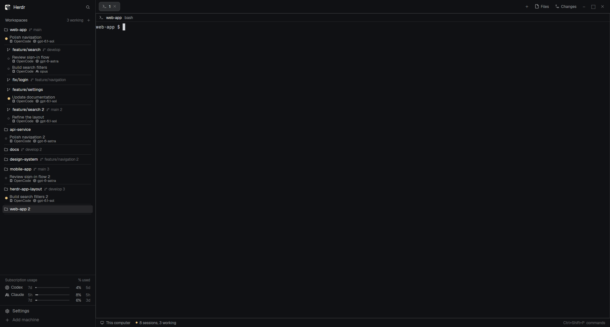
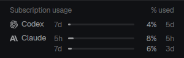

# herdr-setup

> [!NOTE]
> This project is vibe-coded.

A compact [Herdr](https://herdr.dev) layout and reusable mods.

## Layout

**[minimalist-compact](minimalist-compact/RECIPE.md)** — Compact workspaces/worktrees, inline branches, agent session dots, subscription usage and screenshot mode. Self-contained with all six mods.



The optional [OpenCode bridge](https://github.com/Torbraw/opencode-herdr-app-bridge) adds individual OpenCode tabs and model details. Native agent rows work without it.

## Mods

- **[provider-usage](herdr-mods/provider-usage/RECIPE.md)** — Codex and Claude subscription meters using existing local logins. Works independently or bundled with minimalist-compact.

See each folder's `RECIPE.md` for setup, behavior and privacy details.



## Local development

Edit shared usage code in `herdr-mods/provider-usage/mods/provider-usage/`; layout-only mods live under `minimalist-compact/mods/`.

Requires Node.js 22+. Start live testing, then edit repo files:

```sh
node scripts/dev.mjs         # sync now, then watch until Ctrl+C
node scripts/dev.mjs --once  # sync once and exit instead
```

Both commands sync shared usage into the layout bundle and copy runtime files plus the layout JSON/preview into `${HERDR_APP_HOME:-~/.config/herdr-app}`. Herdr hot-reloads them; settings, sessions, caches and unrelated mods stay untouched. Only changed files are written; removed source files are retained at the destinations for manual cleanup. Neither command commits or pushes.

Before overwriting installed files, the command backs up their pre-run versions. Backups and last-deployed baselines live under `${XDG_STATE_HOME:-~/.local/state}/herdr-setup/`, outside Git; the exact path is printed. One command may target a given Herdr home at a time.

Conflicting installed edits stop the command. On first use, existing files must match repo source or its `HEAD`; later runs compare against the last deployment. Preserve any local experiment elsewhere, then restore the installed file from the matching source/baseline and rerun. There is no force overwrite or reverse sync. After a hard crash, remove the printed empty `lock` directory only after confirming no dev command is running.

Run checks before committing:

```sh
node scripts/sync-provider-usage.mjs
node --test tests/*.test.mjs minimalist-compact/mods/minimalist-compact-workspaces/*.test.mjs herdr-mods/provider-usage/tests/*.test.mjs
python3 -m unittest discover -s herdr-mods/provider-usage/tests -p 'test_*.py'
# For each changed mod, also run: herdr-app check <mod-folder>
```

The standalone sync script only updates the repository's bundled usage copy; it does not install. Review the diff before committing/pushing.

See [AGENTS.md](AGENTS.md) for the maintenance workflow.
