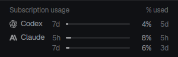

# Provider usage

Codex and Claude subscription meters for [Herdr](https://herdr.dev), independent of the minimalist-compact layout and OpenCode bridge.



## Install

Requires Python 3 and a compatible Herdr mod API. Reads existing local Codex/OpenCode and Claude Code credentials, then contacts the providers' usage endpoints. It never refreshes or rewrites logins; see [RECIPE.md](RECIPE.md) for paths and privacy details.

Ask your agent:

```text
Read ~/.config/herdr-app/AGENTS.md, then add this mod: https://github.com/Torbraw/herdr-setup/tree/main/herdr-mods/provider-usage
```

Or copy this bundle's `mods/provider-usage/` folder to `${HERDR_APP_HOME:-~/.config/herdr-app}/mods/provider-usage/`, then run:

```sh
herdr-app check "${HERDR_APP_HOME:-$HOME/.config/herdr-app}/mods/provider-usage"
herdr-app do pane.split '{"direction":"down","mod":"provider-usage"}'
```

Only the inner runtime folder is installed; docs, preview and tests stay here. If `provider-usage` already exists, review before overwriting. The minimalist-compact layout already includes it, so use that copy.

## Refresh interval

Usage refreshes every two minutes by default. Set `refreshIntervalSeconds` to a positive whole number in `mods/provider-usage/config.js` to change both polling and cache lifetime. Herdr hot-reloads the file on save. When developing in this repo, edit the standalone source and use `node scripts/dev.mjs` from the root to sync it live.

## Development

Edit `mods/provider-usage/`. Run tests from this bundle directory:

```sh
node --test tests/*.test.mjs
python3 -m unittest discover -s tests -p 'test_*.py'
herdr-app check mods/provider-usage
```

From the repository root, `node scripts/sync-provider-usage.mjs` manually copies runtime source into the layout bundle. It leaves docs/tests/previews outside the copy, never deletes, and does not install or publish anything.

See [THIRD_PARTY.md](THIRD_PARTY.md) for artwork sources.
