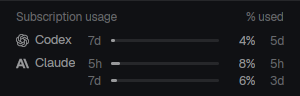

# Provider usage

A compact Herdr panel showing Codex and Claude subscription usage: percentage bars, reset estimates and honest unavailable states. It works independently of minimalist-compact and the OpenCode bridge.

## What you see

- A theme-chrome block headed “Subscription usage”, with a clickable refresh label at the right.
- Codex and Claude icons/names beside compact usage meters: window label, percentage bar, rounded percentage and reset estimate.
- A thin theme-border top separator. Spacing and typography are supplied by the mod, with no configuration required.
- Bars use muted text color, switching to the theme's blocked color at 90%. The panel hides its content when too narrow. No fabricated windows or reset times.

## How it behaves

- Refreshes on initialization and every two minutes by default. `config.js` controls both polling and cache lifetime; saving it hot-reloads the mod. Initial loads reuse a fresh cache; timer ticks and the `provider-usage.refresh` command bypass it and reread current logins.
- Missing logins, expired tokens, rate limits and unavailable endpoints show concise messages. Credentials and HTTP response bodies never appear in errors.
- It only reads usage; it cannot refresh authentication, log in, change plans or manage sessions.

## Built from

This bundle's runtime source is `mods/provider-usage/`. Copy only that inner folder to `mods/provider-usage/` under the Herdr home. Keep this installed name: `main.js` uses it for its Python helper and local SVG assets. No sibling mod is needed. Docs, preview and `tests/` stay outside the installed runtime folder.

- `main.js` uses gpui-kit/gpui-base plus Herdr's `theme`, `exec` and `appHome`, a configurable timer from `config.js` (120 seconds by default) and size-change notifications.
- `model.js` validates provider/window data, clamps percentages and formats reset estimates.
- `usage.py` uses Python's standard library for local login reads, two concurrent HTTPS requests and a usage-only cache.
- `openai.svg` and `anthropic.svg` are bundled locally; sources and terms are in [THIRD_PARTY.md](THIRD_PARTY.md) beside this recipe.
- `mod.json` uses `place: none`; installing the files does not alter the selected layout.

Install the supplied runtime folder as-is, then open it beside a terminal with `pane.split {direction: "down", mod: "provider-usage"}`. The minimalist-compact bundle already includes and places the same mod; install only one copy at that name.

## Watch out

- Requires Python 3 and a compatible Herdr mod API; tested primarily on Linux with Herdr 0.1.13. Other platforms may store credentials differently.
- Reads `~/.codex/auth.json`, OpenCode's SQLite credentials at `$OPENCODE_DB` or `${XDG_DATA_HOME:-~/.local/share}/opencode/opencode.db`, legacy OpenCode `auth.json`, and `~/.claude/.credentials.json`. The SQLite connection is read-only; no login files are refreshed or rewritten.
- Sends bearer tokens only to `https://chatgpt.com/backend-api/wham/usage` and `https://api.anthropic.com/api/oauth/usage`. Explain these reads and network calls before installation.
- Writes usage-only cache data to `${HERDR_APP_HOME:-~/.config/herdr-app}/data/provider-usage.json` with private file permissions. Never publish caches or credentials.
- The reader is local, including when the focused workspace is remote. Provider APIs and login formats can change.
- The preview is a crop of the real layout capture. The authoritative runtime source is `herdr-mods/provider-usage/mods/provider-usage/` relative to the repository root. Copy updates into the layout bundle by running `node scripts/sync-provider-usage.mjs` from that root.

## Done when

1. `herdr-app check` passes for the installed folder and the shown panel has no runtime errors.
2. It renders independently with only the inner runtime folder installed; helper and icons require no workspace mod.
3. Valid returned windows show clamped bars and correct reset formats; missing data gives an honest unavailable state.
4. Initial loads reuse cache only within the configured interval; timer ticks and explicit refresh commands bypass it. Errors expose neither tokens nor response bodies.
5. Model and Python tests pass; review the synced layout copy before publishing.
