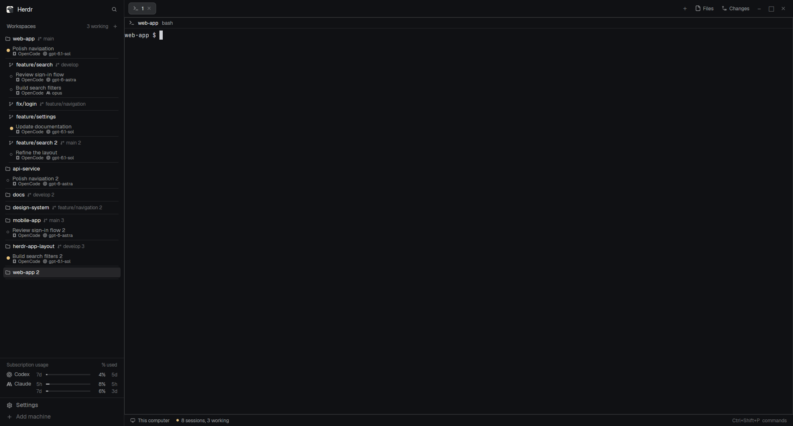

# minimalist-compact

A compact [Herdr](https://herdr.dev) layout with workspaces and worktrees, inline branches, agent sessions, and subscription usage.



## Install

Requires a recent Herdr app (built from its 0.1.13 layout/mod API), Python 3 and Git. Give an agent this folder and ask it to install the layout using `RECIPE.md`, or copy the files yourself:

1. Clone the repo and open its `minimalist-compact/` folder. All paths below are relative to that folder.
2. Copy `layouts/minimalist-compact.json`, `layouts/minimalist-compact.png`, all `mods/minimalist-compact-*` folders and `mods/provider-usage/` into `~/.config/herdr-app/` (or `$HERDR_APP_HOME`). If these names already exist, review the differences before replacing them. Keep this bundle's `THIRD_PARTY.md` and `LICENSES/` with redistributed source.
3. Check the mods and select the layout:

   ```sh
    for mod in "${HERDR_APP_HOME:-$HOME/.config/herdr-app}"/mods/minimalist-compact-* "${HERDR_APP_HOME:-$HOME/.config/herdr-app}"/mods/provider-usage; do
     herdr-app check "$mod" || exit
   done
    herdr-app do layout.switch '{"name":"minimalist-compact"}'
   ```

Zoom, terminal font preferences, logins and machine settings belong to your own installation. The repository contains the layout and custom mods.

## Optional OpenCode companion

Install [herdr-app-bridge](https://github.com/Torbraw/opencode-herdr-app-bridge) to show every OpenCode tab, model/provider metadata and click-to-focus tab navigation. Without it, the layout still shows live coding-agent terminals and usage.

## What runs locally

- Workspace discovery invokes Git and `hc`; inherited Herdr controls can launch terminals and manage spaces/worktrees.
- Usage runs `python3` every five minutes. It reads existing Codex/OpenCode and Claude Code logins, including OpenCode's local credential database when available, and contacts `chatgpt.com/backend-api/wham/usage` and `api.anthropic.com/api/oauth/usage`.
- Credentials remain local; the usage cache contains only usage information. Missing/expired logins display an unavailable state. Provider endpoints and login formats may change.
- The optional bridge exchanges local session metadata through Herdr's `data/herdr-app-bridge` directory.

## Screenshot mode

With this layout selected, replace sidebar workspace, worktree, branch and session labels with stable sample names:

```sh
herdr-app do minimalist-compact-workspaces.screenshot-on
herdr-app shot preview.png
herdr-app do minimalist-compact-workspaces.screenshot-off
```

`screenshot-toggle` also switches modes. Real names, focus targets and sessions stay intact; icons, models, status dots, grouping and spacing stay live. Sidebar label tooltips use sample names too. Mode resets on mod reload.

This masks sidebar labels only. Select a blank OpenCode tab before capturing; terminal content, pane/tab headers, menus, remote-machine headings and Files/Changes remain live.

## Checks

```sh
node --test mods/minimalist-compact-workspaces/*.test.mjs ../herdr-mods/provider-usage/tests/*.test.mjs
python3 -m unittest discover -s ../herdr-mods/provider-usage/tests -p 'test_*.py'
```

See [RECIPE.md](RECIPE.md) for the intended interface and [THIRD_PARTY.md](THIRD_PARTY.md) for provenance. Provider usage is also available [independently](../herdr-mods/provider-usage/README.md); edit its authoritative source under `../herdr-mods/provider-usage/mods/provider-usage/` and run the root sync command before checking the bundled runtime. The `herdr-layout` repository topic enables discovery at herdr.dev/layouts; indexing is handled by Herdr.
