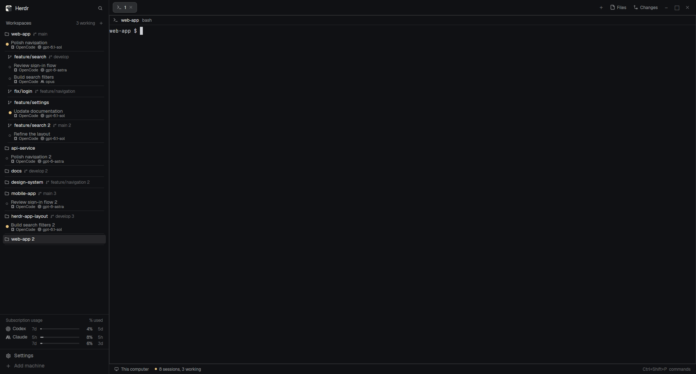

# minimalist-compact

A compact coding workspace for Herdr: worktrees grouped under repositories, OpenCode sessions immediately visible, and small usage meters above Settings.

## What you see

- A compact sidebar: Herdr branding and Search, Workspaces heading with working count and add-space control, a scrolling tree, subscription usage, then Settings/Add machine. There is no sidebar-toggle button beside Search.
- Workspace headers are 24px tall, use folder icons, and place muted branch names directly beside names. Worktrees use branch icons and an 8px indent. A branch identical to the workspace name is not repeated. Long labels truncate with full tooltips.
- Groups are always expanded; thin theme-border separators divide them. Session rows are 32px tall: title on the first line, harness icon/name plus provider icon and model on the second. Session title text is 13px and metadata is 11px. Workspaces also use 13px labels; branches use 11.5px.
- Only session rows carry activity dots. No workspace/worktree aggregate dots, status labels, new-session buttons or session-close buttons.
- Compact subscription usage places provider names beside percentage bars and reset estimates, above the footer.
- The main area has terminal tabs, pane headers and a status bar. Pane borders and configured terminal/outer content padding are zero. Pane activity indicators precede the program icon/name; split/zoom/close controls appear on the right on hover. Optional Files/Changes panels sit to the right.
- Colors follow Herdr's theme: chrome/canvas/background surfaces, muted metadata, selected/raised highlights and border separators. Terminal font/zoom remain the person's preferences; this layout sets sidebar text sizes explicitly.

## How it behaves

- Working: static theme-working dot. Waiting for input/blocked: red (`ansi1`). Done/unread: blue (`ansi4`). Idle: hollow subdued dot. Status text is available in tooltips only on session rows.
- OpenCode tabs use only their own bridge status. Herdr's terminal-wide unread completion cannot identify which tab finished and is used only for native agent rows without bridge metadata.
- Clicking a workspace selects its space; right-click opens its layout-owned menu. Clicking a session focuses its terminal and, with the companion plugin, its specific OpenCode tab. Session/tab right-click opens the containing Herdr tab's menu. These menus retain tab/worktree actions but omit Rename; double-clicking a tab only selects it. Native rename commands remain available.
- Worktrees are grouped under their main checkout via Git metadata. Names/branches follow live folders; ordinary shell panes are omitted from session rows. Agent cycling follows the displayed session order.
- OpenCode tab closing uses OpenCode itself: Ctrl+X then W with its default bindings.
- Usage refreshes automatically every two minutes by default; `mods/provider-usage/config.js` controls both polling and cache lifetime and hot-reloads on save. The bundled `keys.json` adds Ctrl+Shift+R for `provider-usage.refresh`, bypassing the usage cache and rereading current logins. Merge that fragment into existing Herdr keys; preserve unrelated bindings. Missing logins or errors show concise unavailable messages.
- Rate-limited providers pause scheduled requests until `Retry-After`, or for five minutes when unusable; cooldowns survive reloads without pausing the other provider. Explicit usage refresh can retry early. Temporary failures retain credential-matching windows marked “Last known”, with their original capture time in the tooltip; overlapping panel instances deduplicate helper requests.
- Pane and terminal-tab controls use native Herdr commands. Herdr's sidebar shortcut (Ctrl+Shift+B by default) hides/shows the whole sidebar; a tab-bar button can restore it when hidden. There is no narrow rail; saved rails migrate to a hidden full-width sidebar. Individual workspace groups never collapse.
- Screenshot mode (`minimalist-compact-workspaces.screenshot-on`, `screenshot-off`, `screenshot-toggle`) substitutes sidebar labels and their tooltips with stable sample names. It preserves real IDs, actions, grouping, status and models, and resets on reload. Use a blank OpenCode tab for the capture; terminal content and other panels remain live.

## Built from

The root is a sidebar/work row. The sidebar contains brand, scrolling workspaces, usage and footer. Work contains terminal tabs, the active-tab pane block plus optional Files/Changes stack, and status.

Layout mods:

- `minimalist-compact-workspace-chrome`: brand and footer, selected by `props.footer`.
- `minimalist-compact-workspaces`: foreground-filtered agent sessions, grouped spaces/worktrees, inline branches, optional bridge reader.
- `provider-usage`: shared provider bars and Python usage reader, also installable independently.
- `minimalist-compact-terminal-tabs`: native Herdr tabs, panel controls and window controls.
- `minimalist-compact-pane-header`: pane titles, folders and split/zoom/close controls using `props.pane`.
- `minimalist-compact-session-status`: native workspace/branch summary and custom session/working counts.
- `minimalist-compact-menu`: workspace/tab menus, validated targets and native worktree dialogs, without Rename.

The mods use gpui-kit/gpui-base and Herdr's live `spaces`, `panes`, `agents`, `terminals`, `theme`, `shared`, `run`, overlays, `exec`, `hc`, file APIs and folder watchers. The inherited spaces implementation handles Git grouping and remote machines. Only foreground coding-agent processes qualify, so stale OSC state cannot resurrect exited agents.

Shipped dependencies remain Herdr's: Files, Changes, terminal menus, worktree picker, settings, new-menu, program icons and workspace-chrome SVG assets. The cloned chrome includes its own asset copies. Provider artwork comes from Simple Icons and OpenAI's official brand assets; see [THIRD_PARTY.md](THIRD_PARTY.md) for sources.

The optional `herdr-app-bridge` OpenCode V2 plugin is a separate repository. It publishes version-1 PID/terminal-matched JSON snapshots and watches focus-request mailboxes in `data/herdr-app-bridge`. Reactive, coalesced writes avoid heartbeat polling. Herdr watches that directory; only failed watches use a 30-second fallback.

## Watch out

- Tested primarily on Linux with the Herdr 0.1.13 API. Keep shipped Herdr files intact; edit the custom mods. Modern Herdr supplies the runtime, program icons and built-in dialogs.
- The layout must work without the OpenCode plugin. Native agent rows remain available, though individual OpenCode tabs/models require the plugin. The file bridge is local-machine only.
- Git/`hc` execution, Python execution and usage network access are real functionality. Explain them before installing for another person. Usage reads provider credentials locally; publish only source files, never logins, databases, caches or bridge snapshots.
- Provider usage endpoints, credential formats and OpenCode plugin APIs can change. A missing usage window is omitted, never replaced by fabricated data. Keep the meter block tall enough if providers add windows or typography changes.
- Static dots are intentional: continuous spinner animation caused high CPU with software rendering. Preserve deduplicated metadata publication and event-driven updates.
- Herdr centers whole terminal rows, so leftover pixels can appear above/below the grid even with padding set to zero. This layout leaves that native behavior unchanged; do not tune bar heights to one window size.

## Done when

1. Every bundled mod passes `herdr-app check` and `herdr-app status` reports no errors after switching layouts.
2. Live agents appear under their workspace/worktree; shells and exited OpenCode frontends do not. Groups stay expanded with compact headers and separators.
3. With the plugin, multiple OpenCode tabs and models appear and session clicks focus the correct tab. With it disabled, native agent rows still work.
4. Working, blocked, unread done and idle render as distinct session dots, with no duplicate workspace status or inline status labels.
5. Usage bars/reset values or honest unavailable messages appear above Settings, without large blank spacing. Sidebar labels are legible at normal zoom.
6. Idle bridge metadata does not rewrite snapshots. Model/parser/publisher tests pass; the running layout is visually checked after style changes.
7. Workspace/tab menus omit Rename, double-clicking tabs only selects them, and hiding the sidebar leaves no rail. The usage refresh shortcut fetches fresh data without modifying logins.
